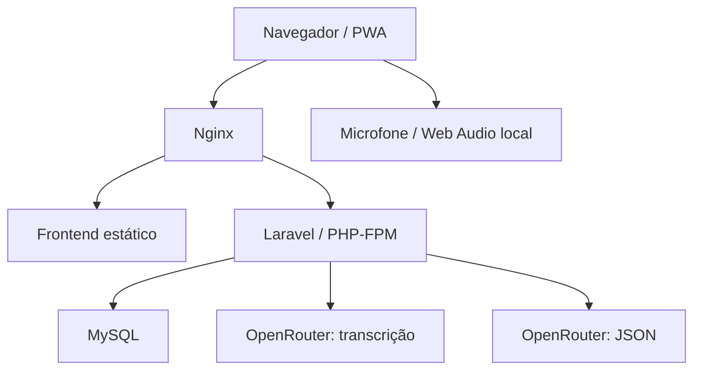

# Arquitetura

## Contexto e tecnologias

| Camada | Decisão preservada | Evidência/limite |
|---|---|---|
| Frontend | Framework7 Core 9.2.0, JavaScript puro, Framework7 Icons 5.0.5 | Versões informadas; lockfile integral não disponível nesta etapa. |
| Build | Vite 8.3.4, Node 22-alpine | Não confundir Vite padrão do Laravel com o frontend separado. |
| Gráficos | Apache ECharts 6.1.0; SVG para donuts dos resumos; canvas/Web Audio para voz | Animação de áudio não exige trocar ECharts nem instalar plugin. |
| Tipografia | Nunito variável local com licença OFL no projeto | Preservar fontes de ícones separadas. |
| API | Laravel 12.70.0, PHP 8.2.x, sessão/Sanctum | Não inferir upgrade por versão usada em testes auxiliares. |
| Banco | MySQL 8.0, ambiente informado 8.0.45 | Fundação menciona 8.4, substituída pelo ambiente aprovado. |
| Publicação | Docker Compose/Nginx e PHP-FPM; web PWA | Reusar infraestrutura existente com cuidado com outros projetos. |
| IA | OpenRouter: transcrição Whisper Large V3; interpretação Gemini 2.5 Flash-Lite | Modelos configuráveis; duas chamadas no backend. |

Não há React, TypeScript, RAG, aplicativo nativo, banco local para lançamentos offline ou integração bancária no estado atual.

## Topologia

A API não expõe a chave da IA ao navegador. O frontend não consulta MySQL diretamente. Assets podem vir do cache do SW, mas dados financeiros dependem da API autenticada.

## Responsabilidades

- `frontend/src/js/app.js`: inicialização Framework7, tema, autenticação e workspace.
- `workspace.js`: usuário em memória, editores ativos, eventos de atualização, ciclo atual e navegação. Não abre múltiplos editores conflitantes; preserva seleção histórica ao voltar do segundo plano.
- `routes.js`: páginas de domínio e ciclo de montagem/destruição. Histórico do navegador e Android precisam respeitar confirmação de saída.
- `transactions/`: listagem, formulário e API; `voice.js` controla estado da captura/processamento e `voice-visualizer.js` mede o sinal.
- `budgets/`, `goals/`, `categories/`, `reports/`, `cycles/`, `settings/`: módulos por domínio. `demo/pages.js` contém o menu Mais real apesar do nome histórico.
- `shared/`: componentes comuns de calendário, seletores, dinheiro, HTML, tema, notificações e gráficos; nem todos os arquivos foram recuperados integralmente.
- `backend/routes/api.php`: rotas; montagem em `/api/v1` é observada no cliente e deve ser conferida no bootstrap real.
- FormRequests: validação/autorizações de entrada. Resources: serialização. Controllers: orquestração e códigos HTTP.
- `FinancialCycles`: única fonte de datas de ciclo, com lock/versionamento.
- `FinancialSummary`: agregações compartilhadas de lançamentos. `BudgetReader/Writer`: cálculo/cópia e persistência dos limites. `Goals`: ledger independente com controle de concorrência. `TransactionVoice`: pipeline sem persistência financeira.

## Dados e consistência

A data do lançamento define pertencimento ao ciclo em consulta; `transactions` não possui `financial_cycle_id` comprovado. Orçamentos possuem esse vínculo porque são limites associados ao calendário. Consultas agregadas eliminam a necessidade de uma tabela de totais mensais persistidos.

Objetivos mantêm `saved_cents` junto do histórico e atualizam ambos transacionalmente. Não aplicar automaticamente eventos de objetivos ao financeiro. Ver [modelo](modelo-dados.md) e [regras](regras-negocio.md).

## Comunicação e estados

Mesma origem em produção; Vite proxy de desenvolvimento encaminha `/api`, `/sanctum` e `/up` ao Nginx. JSON é o padrão, exceto upload de voz em multipart. Cliente usa credenciais same-origin e token XSRF de cookie para mutações. A captura usa MediaStream no aparelho e envia o Blob somente ao finalizar.

Não há fila ou scheduler obrigatório demonstrado para calendário/voz; consultas materializam ciclos sob demanda e a chamada de IA é síncrona. Não introduzir Redis/RabbitMQ/worker por semelhança com outros projetos do usuário.

## Atualização e isolamento de escopo

`frontend/build/pwa-plugin.js` só roda em build, exige base `/`, lista recursos permitidos e gera versão por hash. O Vite de `backend/` é resquício padrão de Laravel e não é o servidor das telas do app. A instalação de produção deve publicar o `frontend/dist` coerente com seu SW.

A remoção Pluggy eliminou tela, menus, endpoints e estrutura específica. Código histórico de integração não é componente atual. Não restaurar arquivos antigos ao aplicar este material documental.

## Evolução

ADRs em [decisoes/README.md](decisoes/README.md) registram escolhas relevantes. O escopo futuro de CSV e as propostas de recorrência/análise por IA não alteram o modelo atual antecipadamente. A primeira tarefa é fixar commit e manifests reais: [TAR-037](tarefas.md#tar-037).
