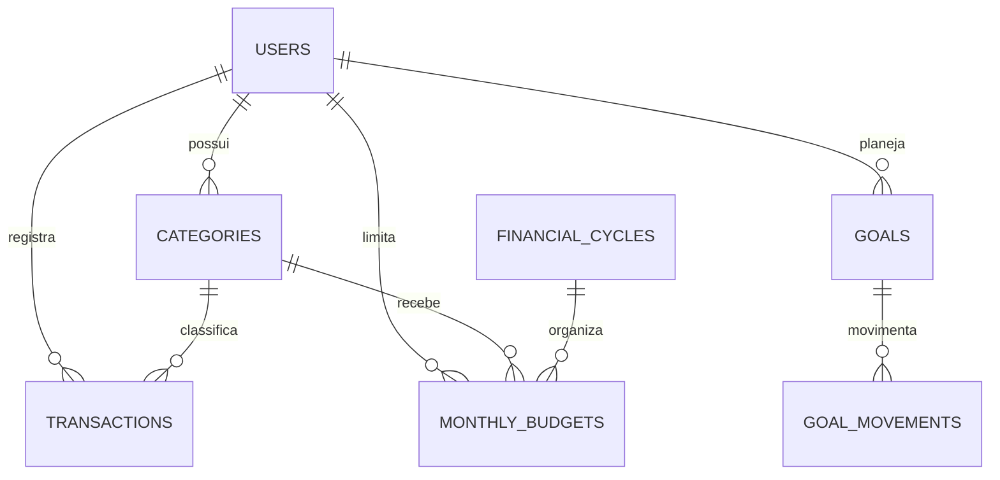

# Modelo de dados

## Convenções e nível de certeza

Este é o modelo **atual lógico e físico onde verificado**, não um script para recriar o banco. `DAT-001/002/003` têm campos sustentados por contrato/código e fundação, mas suas migrations iniciais completas não estavam na amostra. `DAT-004` tem model/resource e migration de observação; restrições iniciais exigem reconciliação. `DAT-005/006/007/008` têm migrations recuperadas. Não inventar tamanhos/índices físicos ausentes. Campos `*_cents` são inteiros; datas de negócio usam DATE.

O calendário global não implica acesso cruzado entre usuários. `transactions` é associado temporalmente ao ciclo, não por FK de ciclo confirmada.

## DAT-001

### users

Implementado, C parcial/R. Campos lógicos: `id`, `name`, `email`, `password` (hash), timestamps; metadados Laravel usuais devem ser conferidos antes de afirmar presença. E-mail identifica o acesso; unicidade é requisito do produto/fundação, índice real a confirmar. Relações com categorias, lançamentos, orçamentos e objetivos. Não existe papel ADMIN/gestor comprovado nem cadastro público autorizado.

**Ciclo de vida:** provisionamento fora de um cadastro público; perfil editável; senha trocada no fluxo seguro. Exclusão de usuário e expurgo total não estão especificados. Senha nunca retorna nas APIs descritas.

## DAT-002

### categories

| Campo lógico | Conteúdo | Evidência |
|---|---|---|
| id, user_id | Identidade e proprietário | Relations/queries/controllers |
| name | Texto, UI até 80 | Formulário; validar regra backend completa |
| type | income ou expense | FinancialType e filtros |
| icon | Nome do catálogo | Category::ICONS referenciado |
| color | Cor de catálogo/hex validado | UI safeColor; regra backend a conferir |
| is_active | Ativa/inativa | Filtros e validação de vínculos |
| timestamps | Criação/alteração | Fundação e uso Laravel |

Índices e unicidade física por nome/tipo/usuário não foram auditados integralmente; o seeder faz firstOrCreate(type,name) dentro do usuário, mas isso não prova índice único. Não acrescentar soft delete à entidade só por semelhança com lançamento.

**Ciclo de vida:** categoria ativa aceita novos vínculos; inativa preserva exibição dos históricos. Exclusão/troca de tipo com vínculos dependem da implementação completa; não autorizar cascade para apagar lançamentos.

## DAT-003

### transactions

Campos: `id`, `user_id`, `category_id`, `type`, `amount_cents`, `description`, `transaction_date`, `notes`, timestamps e `deleted_at` (uso de withTrashed/trashed/delete comprova exclusão lógica no fluxo). `description` até 255; notes até 2000, nullable; valor e datas em RN-002/RN-003.

FK lógica de categoria; usuário coincidente deve ser validado na aplicação, pois FK simples de category_id não demonstra igualdade de proprietário. Índices `(user_id,transaction_date)`, `(user_id,type,transaction_date)` e `(user_id,category_id,transaction_date)` foram especificados na fundação; confirmar existência com SHOW INDEX antes de declarar instalados.

`cycle_key` é atributo de resposta calculado após gravação, não coluna confirmada. `external_transaction_id` foi removida; não adicionar novamente. Não existem campos aprovados para cartão, fatura, conta bancária ou status previsto/pago.

**Ciclo de vida:** criado/atualizado transacionalmente, exclusão lógica, expurgo físico ainda sem política. Datas podem existir no futuro dentro dos limites aceitos e contam no recorte consultado; não transformar data em promessa de recebimento confirmado.

## DAT-004

### monthly_budgets

Campos: `id`, `user_id`, `category_id`, `year`, `month`, `limit_cents`, `financial_cycle_id`, `notes`, timestamps e `deleted_at`. `financial_cycle_id` foi adicionado nullable com FK para financial_cycles/restrictOnDelete; o calendário faz backfill de vínculos nulos. Model preenche ciclo na criação.

Notes é TEXT nullable, migration `2026_11_01_000007_add_notes_to_monthly_budgets.php`, validação até 2000 caracteres. `spent_cents`, `remaining_cents`, `used_percent` e `status` são derivados por consulta/serviço e não campos graváveis do payload.

Identidade funcional única por usuário/categoria/year/month; índice inicial físico deve ser confirmado. Nome monthly_budgets é legado: os limites atuais são de **ciclo**, não mês-calendário. Não renomear tabela por iniciativa documental.

**Ciclo de vida:** ativo/excluído logicamente; recriação pode restaurar registro. Cópia cria/restaura limites no destino, não duplica despesas. Mudança futura de corte mantém ID de ciclo e orçamento associado.

## DAT-005

### financial_cycle_settings

Migration verificada: singleton `id` unsignedTinyInteger PK; `initial_cut_day` e `cut_day` unsignedTinyInteger nullable; `version` unsignedInteger default 0. Não há user_id. Migration insere id=1 sem dia definido. Não há timestamps nesta migration.

Corte efetivo futuro e calendário persistido permitem representar o agendamento sem obrigar coluna pending_cut_day; `pending_cut_day` é resposta derivada comparando próximo/atual. Não inventar essa coluna no banco.

## DAT-006

### financial_cycles

Migration verificada: `id`; `year` unsignedSmallInteger; `month` unsignedTinyInteger; `start_date` DATE unique; `end_date` DATE indexada; `cut_day` unsignedTinyInteger; unique(year,month). Não há user_id nem timestamps nessa migration.

Datas persistidas são fonte de verdade. Ciclos iniciados preservados; futuras projeções atualizadas em mudança de corte com IDs estáveis. Materialização acontece sob lock, sem cron obrigatório. Não apagar ciclos ao limpar lançamentos.

## DAT-007

### goals

| Campo | Tipo/restrição verificados |
|---|---|
| id | PK |
| user_id | FK users, restrictOnDelete |
| name / icon | VARCHAR 80 / VARCHAR 40 |
| target_cents / saved_cents | unsignedBigInteger; saved default 0 |
| deadline | DATE nullable |
| status | VARCHAR 10 default active; valores de API active/archived |
| archived_at / completed_at | timestamp nullable |
| version | unsignedInteger default 1 |
| request_key | UUID |
| request_hash | VARCHAR 64 |
| created_at / updated_at | timestamps |

Unique(user_id,request_key); index(user_id,status,id). target>0 e saved≥0/limite dependem de validação/serviço além do tipo SQL. Conclusão é archived com completed_at. Não há delete lógico/físico de objetivo exposto pela API atual.

## DAT-008

### goal_movements

Migration verificada: `id`; `goal_id` FK goals/restrictOnDelete; `type` VARCHAR12 (contribution/withdrawal); `amount_cents` unsignedBigInteger; `movement_date` DATE; `notes` VARCHAR1000 nullable; `request_key` UUID; `request_hash` VARCHAR64; timestamps. Unique(goal_id,request_key); index(goal_id,movement_date,id).

Não possui user_id direto: propriedade deriva do objetivo e deve ser validada antes de consulta/escrita. Movimento editável ou excluível enquanto objetivo ativo; exclusão física exige recompor saved_cents com lock e validar saldo. Não possui FK para transactions.

## DAT-009

### Sessões e infraestrutura Laravel

Autenticação usa sessão e middleware auth:sanctum. `.env.example` recuperado indica SESSION_DRIVER=database, mas não prova a configuração da VPS. Tabelas sessions, password_reset_tokens, cache e jobs dependem da configuração/migrations reais; sua existência e esquema precisam ser inventariados. Não documentar refresh token, JWT ou MFA como existentes.

## DAT-010

### Rascunho de voz e áudio temporário

Não há tabela nova. Estado efêmero: MediaStream/Blob no navegador; upload temporário PHP; transcrição e objeto `{type,description,category_id,amount_cents,transaction_date,notes}` no processamento. `is_single_transaction` é controle da extração e retirado da resposta de draft.

Áudio/transcrição não são persistidos pelo serviço no banco. A transcrição ainda pode ser retornada no contrato e usada no transporte, embora o link de exibição tenha sido removido. Ausência de armazenamento local não prova ausência de retenção externa; ver segurança/privacidade.

## DAT-011

### Preferência de tema

localStorage `minhas-financas.theme` com light/dark. Metadado local do dispositivo, sem conta financeira, senha ou chave. Limpeza indiscriminada do storage pode apagar preferência e interferir em outros estados da PWA; não é procedimento regular de atualização.

## DAT-012

### Recursos PWA

Arquivos públicos versionados e caches do SW, não banco financeiro. Build lê manifest/ícones/fonte/offline e escreve mf-build/sw.js. CacheStorage, metadados e política de descarte do SW efetivo devem ser conferidos; nenhum dado privado deve ser promovido a recurso público do precache.

## Dados removidos e futuros

Tabelas de operação/estado bancário e coluna externa de transactions pertencem à integração removida (FON-05). `recurrence_rules` é apenas proposta histórica; não afirmar criada. Não criar tabelas de faturas, contas, chat ou armazenamento de áudio por antecipação.

## Limpeza e recuperação

TRUNCATE de transactions apaga registros de **todas** as contas e reinicia IDs; não equivale a excluir pela aplicação e não é rollback. Objetivos e limites devem permanecer independentes, enquanto agregados de gastos passam a zero. Antes de qualquer limpeza real, consultar FKs atuais e realizar backup verificável; não desativar validação de FK sem entender o erro. A restauração deve seguir [operacao-deploy.md](operacao-deploy.md).
